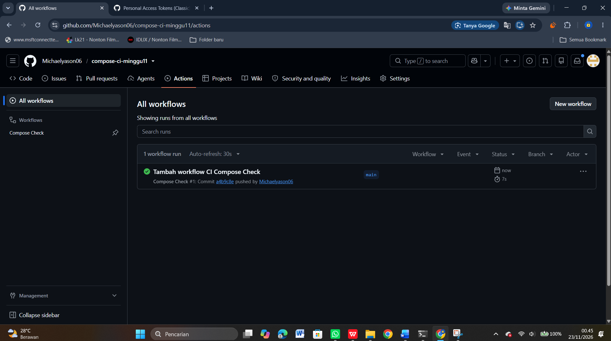
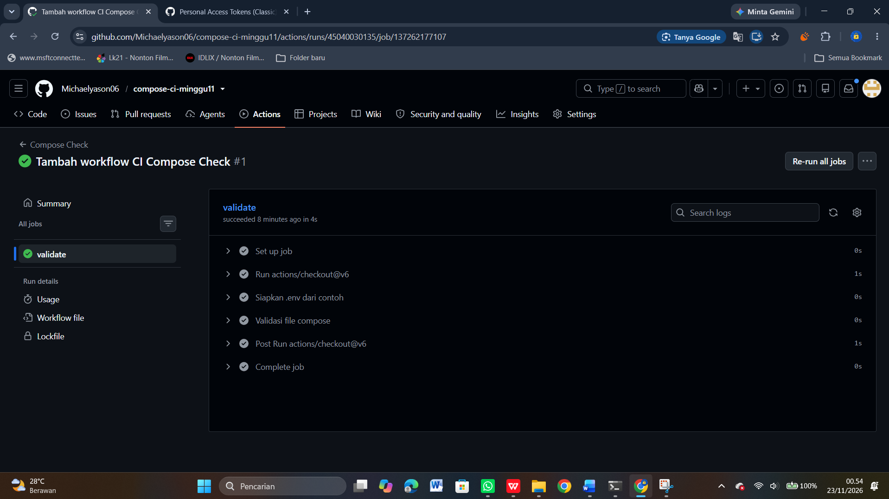
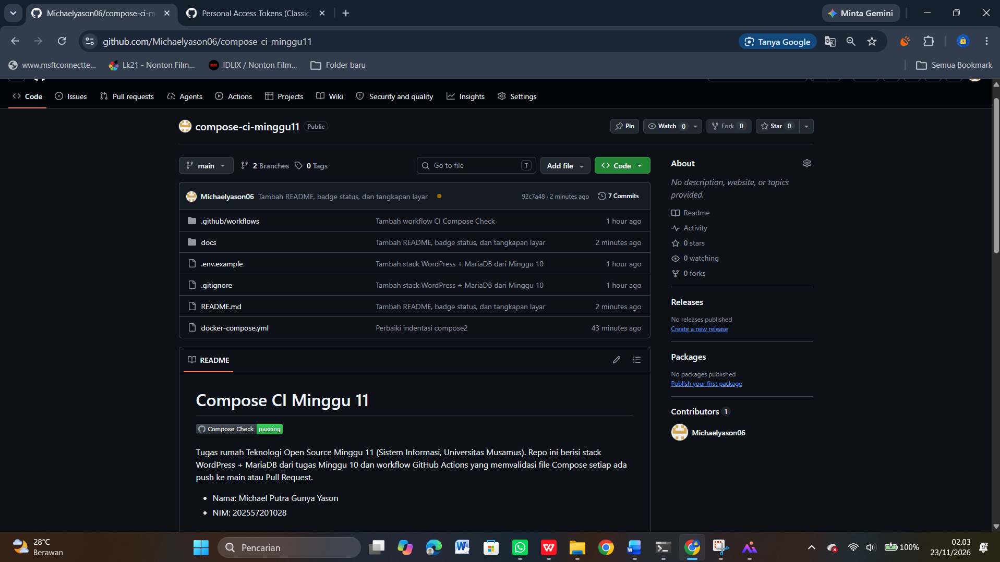
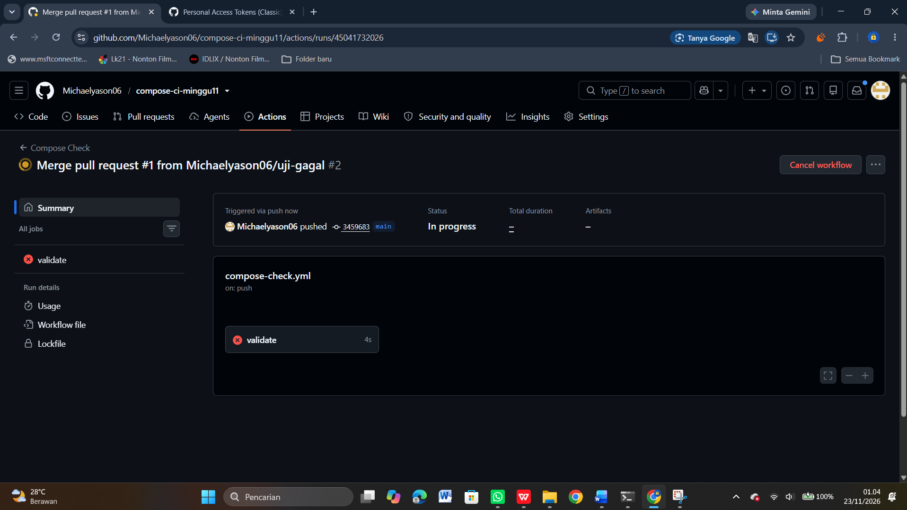
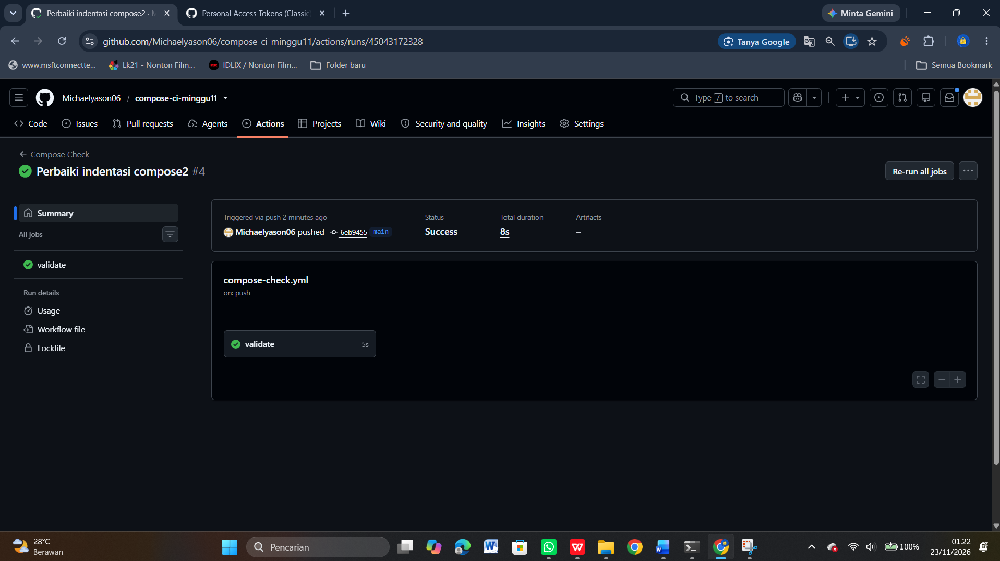

# Compose CI Minggu 11
 

 
Tugas rumah Teknologi Open Source Minggu 11 (Sistem Informasi,
Universitas Musamus). Repo ini berisi stack WordPress + MariaDB dari
tugas Minggu 10 dan workflow GitHub Actions yang memvalidasi file
Compose setiap ada push ke main atau Pull Request.
 
- Nama: Michael Putra Gunya Yason
- NIM: 202557201028
 
## Isi repositori
 
- docker-compose.yml: stack WordPress + MariaDB
- .env.example: contoh variabel lingkungan (bukan sandi asli)
- .gitignore: menjaga file .env tidak ikut ter-commit
- .github/workflows/compose-check.yml: workflow CI
- docs/: tangkapan layar bukti pengerjaan
 
## Cara menjalankan stack
 
```bash
cp .env.example .env
nano .env   # ganti nilai contoh dengan sandi sendiri
docker compose up -d
```
 
Lalu buka http://localhost:8080 di browser untuk menyelesaikan
instalasi WordPress. Untuk menghentikan stack: docker compose down
 
## Cara kerja CI
 
Workflow compose-check.yml berjalan pada push ke main dan pada Pull
Request. Job validate menyalin .env.example menjadi .env di runner,
lalu menjalankan docker compose config -q. Kalau file Compose salah
tulis, job menjadi merah.
 
## Bukti
 





 
## Sumber bantuan
 
- Materi Minggu 11 (CI/CD Pipeline dengan GitHub Actions) dan format
  tugas dari asisten dosen
- Dokumentasi GitHub Actions: docs.github.com/actions
- Bantuan dari teman dan bantuan dari AI(Claude dan Chatgpt)
